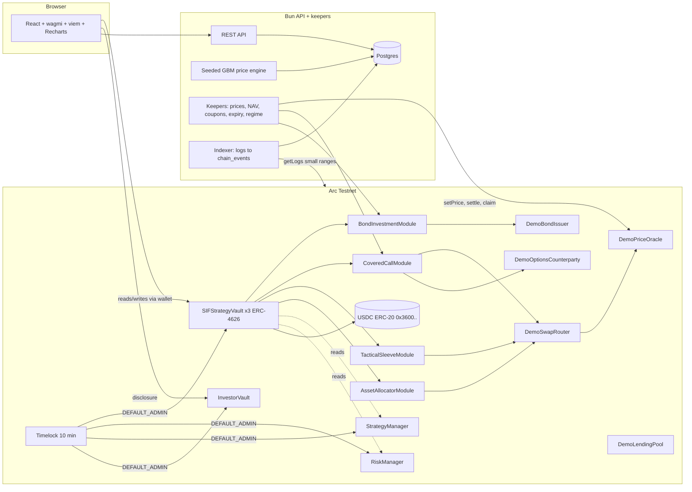
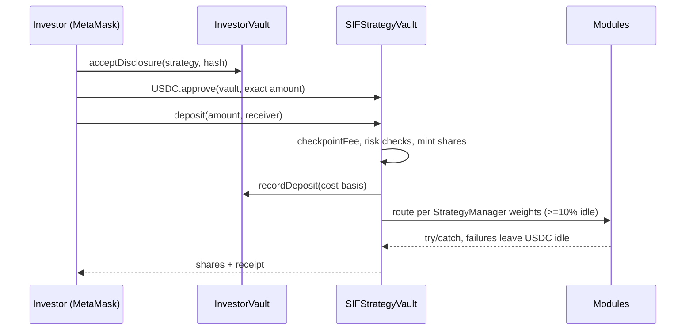

# ARCWEALTH architecture

Hackathon demo on Arc Testnet (chain 5042002). Demo tokens have no monetary value. Not investment advice.

## Deposit sequence

## Honesty tiers
| Tier | Meaning | Examples |
|---|---|---|
| LIVE-TESTNET | Real Arc contract we do not own | USDC, EURC, cirBTC, WETH, App Kit, Morpho |
| DEMO-ONCHAIN | Our stand-in, real txs, no value | demo bonds, dBTC.., options counterparty, lending pool, swap router |
| SIMULATED-OFFCHAIN | Backend computed | GBM prices, charts, backtests, Black-Scholes premium inputs |

Every API figure carries `tier`; the UI renders a badge. Demo/simulated figures are labelled "Demo yield (testnet, no monetary value)".

## Components
- Contracts: see CONTRACTS.md. Deployments: `deployments/arc-testnet.json`.
- Backend (`server/`): Bun HTTP server on :3001 (Vite proxies `/api`). Postgres via Bun.sql (see DB_SCHEMA.sql).
- Keepers (`server/keepers.ts`): hold the keeper key from `DEPLOYER_PRIVATE_KEY`. Every tx uses EIP-1559 type 2 with `maxFeePerGas >= 20 gwei`.
- Indexer (`server/indexer.ts`): small-range `eth_getLogs`, rotates fallback RPCs with backoff, idempotent on `(tx_hash, log_index)`, dedupes USDC Transfer by emitter (ERC-20 `0x3600..` vs native system emitter `0xffff..fffe`).
- Frontend (`src/`): React + Vite (Next.js in the brief is replaced, see ASSUMPTIONS).

## Arc rules enforced
Native gas USDC is 18 decimals, the ERC-20 is 6; all accounting uses the ERC-20 view. maxFeePerGas floor 20 gwei. No push loops (pull claims). Zero-address recipients rejected. No native value to contracts. Receipts awaited before UI updates.
